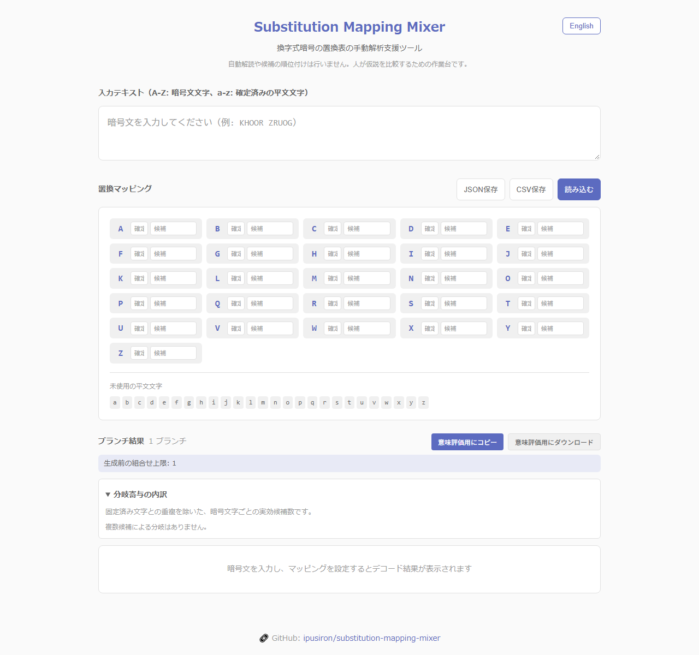

<!--
---
id: day105
slug: substitution-mapping-mixer

title: "Substitution Mapping Mixer"
subtitle_ja: "換字式暗号の手動解析ワークベンチ"
subtitle_en: "Manual substitution-cipher mapping workbench"
description_ja: "換字式暗号の置換表を手動で解析するためのWebツール。確定マッピングと候補マッピングを管理し、複数の仮説をブランチとして比較できます。"
description_en: "A browser tool for manually analyzing substitution-cipher mappings by managing fixed and candidate mappings and comparing hypotheses as branches."
category_ja:
  - 暗号解析
  - 換字式暗号
category_en:
  - Cryptanalysis
  - Substitution Cipher
difficulty: 2
tags:
  - substitution-cipher
  - monoalphabetic-substitution-cipher
  - cryptanalysis
  - manual-analysis
  - branching
  - ctf-support
repo_url: "https://github.com/ipusiron/substitution-mapping-mixer"
demo_url: "https://ipusiron.github.io/substitution-mapping-mixer/"
hub: true
---
-->

# Substitution Mapping Mixer - Manual substitution-cipher mapping workbench


[](https://ipusiron.github.io/substitution-mapping-mixer/)

**Day105 - Security Tools Made with Generative AI 200**

**Substitution Mapping Mixer** is a browser-based workbench for manually analyzing monoalphabetic substitution ciphers. It keeps confirmed mappings separate from unresolved candidates and lets you compare the resulting decoding branches.

This is not an automatic solver. It does not score, rank, or prove the correctness of a plaintext candidate.

---

## 🌐 Demo

👉 **[https://ipusiron.github.io/substitution-mapping-mixer/](https://ipusiron.github.io/substitution-mapping-mixer/)**

The tool runs entirely in your browser.

---

## 📸 Screenshot

>
>
>*Initial screen*

---

## ✨ Features

- Manage fixed mappings and unresolved candidate mappings separately
- Generate branches only after checking a 200-combination safety limit
- Enforce one-to-one plaintext assignments within generated branches
- Highlight conflicting confirmed assignments without hiding the user's input
- Fix or exclude each candidate through tap-friendly controls
- Show each ciphertext letter's effective contribution to branch growth
- Save and restore mappings in JSON or CSV
- Link ciphertext occurrences with mapping rows through hover highlighting
- Copy or download branches for [Semantic Candidate Ranker](https://github.com/ipusiron/semantic-candidate-ranker)
- Switch the interface between Japanese and English
- Keep all entered data in the browser without server communication

---

## 📖 Usage

### Working text

- **A-Z (uppercase):** undecoded ciphertext characters
- **a-z (lowercase):** plaintext characters confirmed and entered by the user
- **Other characters:** preserved as entered

### Mappings

For each ciphertext letter, enter either one fixed plaintext letter or multiple candidate letters.

| Field | Meaning | Example |
|---|---|---|
| Fixed | One confirmed plaintext letter | `e` |
| Candidates | One or more possible plaintext letters | `aio` |

A single candidate is treated as resolved. Two or more candidates participate in branching. Combinations that reuse the same plaintext letter are excluded. If the pre-generation upper bound exceeds 200 combinations, generation stops before creating the branches.

The displayed branch count is calculated after the one-to-one constraint is applied. The upper bound can therefore be larger than the number of displayed branches.

Candidate chips appear below a row after you enter candidates. Select the letter button to make it fixed, or select the adjacent × button to remove only that candidate.

### Save and load mappings

| Action | Saved data | Behavior when loaded |
|---|---|---|
| **Save JSON** | Working text and all A-Z mappings | Restores the text and mappings |
| **Save CSV** | All A-Z mappings | Restores mappings without changing the working text |
| **Load** | A `.json` or `.csv` file | Validates all 26 rows before applying anything |

Imports are limited to 128 KiB. The tool validates the format identifier, version, A-Z rows, lowercase letters, and duplicate candidates. Invalid files do not change the current state, and file contents are not sent to a server.

### Export

The copy and download buttons produce blocks accepted by [Semantic Candidate Ranker](https://github.com/ipusiron/semantic-candidate-ranker):

```text
branch=B1
mapping=Q->u
dear friend i do not know whether you are at the house
```

The mapping line contains only the selections specific to that branch. The tool does not send the exported text anywhere by itself.

---

## 🎯 Use case

Suppose frequency analysis suggests the fixed mapping `Q → e`, while `X → {a, o}` and `Z → {r, s}` remain unresolved. The tool lays out the four resulting plaintext hypotheses in a stable vertical list so that you can compare them manually. Fixing `X → a` through its candidate chip immediately narrows the list to two branches.

Use JSON to pause and resume with the working text intact. Use CSV when you want to exchange only the A-Z table. If the contribution breakdown shows `A × 5` and `X × 2`, reducing A first has the larger effect on the upper bound.

Use context or a separate frequency-analysis tool to narrow large candidate sets below the 200-combination limit. Semantic ranking in a related tool can help order candidates, but it does not establish that any candidate is correct.

---

## 🔗 Related tools

- [Semantic Candidate Ranker](https://github.com/ipusiron/semantic-candidate-ranker) - Ranks exported plaintext candidates by semantic similarity.
- [Frequency Analyzer](https://github.com/ipusiron/frequency-analyzer) - Examines character frequencies before mapping work (Day009).

---

## 📁 Directory structure

```text
substitution-mapping-mixer/
├── index.html          # Main page and CSP
├── style.css           # Responsive presentation
├── logic.js            # Testable branching and decoding core
├── script.js           # UI behavior and localization
├── README.md           # Japanese documentation
├── README.en.md        # English documentation
├── package.json        # Test command
├── test/               # Node.js tests
├── SPEC.md             # Functional specification
├── UI_SPEC.md          # UI specification
├── LICENSE             # License
└── assets/
    └── screenshot.png  # Screenshot
```

---

## 🛠️ Environment and tests

- Use a current major browser. The page also works when `index.html` is opened directly.
- Run `npm test` with Node.js 22. No package installation is required.

---

## 📄 License

See [LICENSE](LICENSE).

---

## 🛠️ About this tool

This tool is part of the **Security Tools Made with Generative AI 200** project, which develops and publishes security-related tools with AI assistance.

See the project page for details and other tools:

🔗 [https://akademeia.info/?page_id=44607](https://akademeia.info/?page_id=44607)
